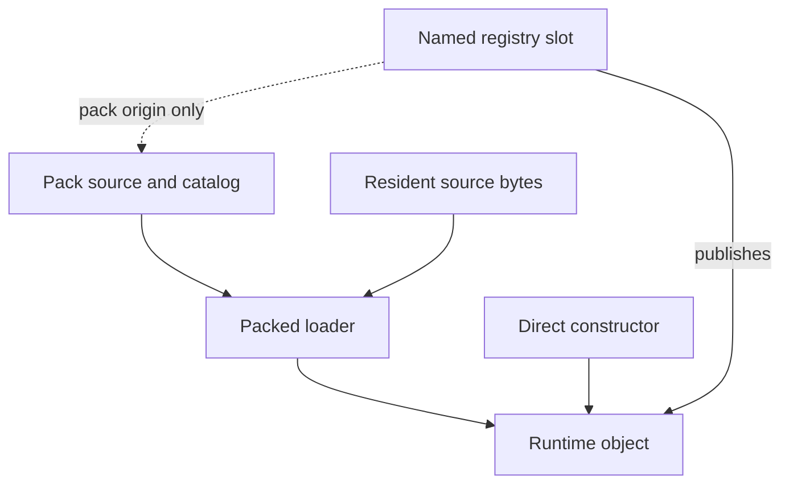

# Resource, Runtime Object and Pack Refactor

**Status:** Proposed architecture and migration specification; not implemented.
**Date:** 2026-09-17; installation/publication and minimality review revised 2026-11-06.
**Reviewed baseline:** `cce1ea6a94cae53810c257ec996994c8d3718fa9`.

This document specifies the intended replacement for eager activation and
priority-stacked resource resolution. Breaking API changes are allowed; preserve
useful cache invalidation, not obsolete signatures. Until a migration step lands,
the current
[Resource System](resource.md), [Async Loading](async-loading.md) and
[Pack Format](ntpack.md) describe implemented behavior. Do not treat the proposed
API names below as existing functions. Update those chapters alongside each
implementation step; do not leave two competing descriptions of shipped behavior.

Related: [Principles](../core/principles.md),
[API contracts](../core/api-contracts.md), [Runtime formats](runtime-formats.md),
[Frame lifecycle](../runtime/frame-lifecycle.md).

## 1. Decisions and scope

The target architecture has three independent concepts:

- A **runtime object** is usable CPU/GPU data implemented by its type module. Its
  lifetime owner is either its creator or the registry after ownership transfer.
  It can be created without a pack or a resource-registry entry.
- A **resource** is a stable, named registry entry: identity, type, selected
  origin, requested residency and current availability. It may have no object.
- A **pack** is an immutable source of named, serialized asset entries. It owns
  a catalog, reload location and optionally resident source bytes.

The game chooses which resources to load, unload and replace. The engine executes
those commands and maintains safe handles, ownership and publication. There is
no game-consumer reference count, automatic reachability traversal, dependency
loading or automatic eviction of wanted runtime objects.

The agreed behavior is:

1. Loaded objects keep no pointers into pack bytes.
2. Creating a resource handle does not load an object.
3. `load` and `unload` address one resource. Group operations are explicit helpers.
4. Virtual packs are removed. Runtime objects are created directly and may be
   registered by name without any pack.
5. One logical name has one committed binding; packs have no priority. Initial
   installation and replacement use one installation operation: prepare privately,
   then publish when ready. A usable current object remains published meanwhile.
6. The engine attempts to restore wanted pack-backed resources after loss of
   their runtime data. The game recreates runtime-origin resources.
7. The game can enumerate the resource registry, including unready entries.
8. No mandatory creation recipe, retained generator callback or game factory
   framework is introduced.
9. Consumers may retain stable resource references. Changing their selected
   objects invalidates dependent caches; the game need not reassign every sprite.
10. Keep the global publication epoch as a synchronization optimization. Atlas
    revisions and font-local source checks determine which caches actually change.

A resource retains one committed source/object and at most one pending source
selection with its progress/outcome. A failed preparation preserves the current
object and binding. This needs no separate operation pool, public staging resource,
priority candidate, or replace/swap protocol.

Source selection is game policy. The target registry has no pack-priority field,
automatic provider selection, or automatic fallback to another source. Opening a
pack never changes an existing binding. The game explicitly chooses sources and
coordinates texture, material and runtime-object changes when switching content.
Do not add a second automatic selection mode with manual overrides.

This proposal also makes the necessary ownership choice explicit: registration
of a standalone runtime object into the managed registry **consumes ownership**.
The engine then destroys it on unload. This is a deliberate breaking change from
the current borrowed virtual-pack contract, not an implicit change to that API.
The game still owns recreation policy and source data for runtime-origin objects.

Explicit source selection and dependent cache maintenance are different duties.
The game chooses the replacement; the engine ensures that a sprite using that
resource sees its new UVs, geometry and pages. This does not select a source,
load a dependency or acquire gameplay ownership automatically.

Direct type constructors remain usable without a pack or registry. Existing
resource-aware font/sprite/material APIs can use named entries, including
consumed runtime objects. This proposal does not require replacing every consumer
with concrete-object-only APIs or introducing a separate shared AtlasBinding pool.

Out of scope: a new pack container, HTTP range streaming, background worker
decoding, automatic scene lifetimes, a mod/override stack, a generic dependency
graph, and new animation/audio features. These are not prerequisites for the
refactor. Existing binary formats remain unless a specific type needs a change.

## 2. Current behavior and why it changes

Preserve stable slots, activators, async pack I/O, budgeted activation, copied
metadata, canonical ownership, global epoch and type-local cache reconciliation.
Reconcile the reviewed baseline with current code before implementing each task.

The coupling at the reviewed baseline was:

- Mount/load/parse registers entries; activation visits every canonical owner,
  independently of resource requests.
- Font PIN_BLOB retains the entire pack for lazy glyph decode.
- BLOB access/readiness depends on source residency rather than an owned object.
- Font/atlas construction depends on publication callbacks.
- Priorities select target/published winners and automatic fallbacks.
- Virtual packs publish borrowed game-owned handles.

Migration status: step 1 now gives FONT and BLOB owned payloads. FONT activation
copies its compact source and no longer uses publication callbacks. PIN_BLOB and
its accounting/cleanup paths are removed; BLOB access survives pack-byte eviction.
The current resource chapter documents these shipped contracts. The remaining
steps below are still proposed.

Mesh upload already stops retaining source bytes after construction. Atlas already
copies geometry; preserve useful owned data while extracting standalone objects.
Current re-fetch code checks retained size and CRC, unlike the reviewed baseline;
reuse its regression test when completing #508.

Immediate installation/publication rules, explicit pages and UI measurement
invalidation below are target contracts, not claims about shipped behavior.

## 3. Data model

### 3.1 Identity and stable handles

Keep `resource_id` as the existing 64-bit name hash and `nt_resource_t` as a stable
32-bit registry index. A logical name may differ from a pack entry's name.

`request(name, type)` returns the existing slot or creates an empty one. It sets
neither an origin nor loading demand. `find(name)` remains a pure lookup.
Requesting an existing name with a different type is a programmer error.

Slots are not recycled until registry shutdown, including after unbinding or
pack removal. Shutdown invalidates all handles. The existing configured slot
capacity remains explicit; unbinding does not recover that capacity.

The hash is the runtime identity. Readable names use the existing optional hash
labels; this design does not require storing full strings in every release slot.

### 3.2 Registry entry

The logical information associated with an entry is:

- name hash and immutable resource type;
- committed origin: `NONE`, `PACK` or `RUNTIME`;
- for `PACK`, a specific pack instance and entry identity;
- `wanted`: the latest explicit load/unload intent;
- effective state and current runtime object, if any;
- an optional pending source selection and progress/outcome, separate from current
  availability; retain an unpublished object only when its type must wait after
  construction;
- failure information distinguishing a failed installation from current availability;
- bounded type-specific binding data where needed, such as an atlas's explicitly
  assigned page resources and local revision; not lifetime region-index history.

This is a contract, not a required C struct layout. Do not duplicate canonical
owner state in every alias or introduce a second independently mutable readiness
flag. Pack-entry records describe sources; the resource API owns the public view.
Synchronous construction uses a local candidate handle and publishes it in the
same lifecycle call. Do not allocate a generic operation record for each attempt.
Shared canonical preparation progress/errors are derived through the selected
source, not mirrored independently in each alias's pending state.

### 3.3 Origin and ownership are different

Represent origin with one tagged source descriptor: a kind and its associated
data, naturally expressed as a C enum plus union. The initial kinds are `NONE`,
`PACK` and `RUNTIME`; do not maintain a second independently mutable origin tag.
The pending operation uses its own requested source descriptor; it does not
change the committed source before publication. This is not a duplicate mutable
origin tag for the same binding.
Source kind is independent of resource type: a texture remains a texture whether
it comes from a pack or is created by the game.

The `PACK` payload identifies a specific pack instance and the named entry within
it. The file path/URL belongs to the pack record, not to every resource descriptor.
Use stable instance identity, not a bare pack name or an unchecked reusable index.
`NONE` and `RUNTIME` have no engine reconstruction payload in this version.

`PACK` means the engine knows where to obtain the same content again. The origin
survives object unload and source-byte eviction. It is not a borrowed pointer into
the catalog/blob and must not accidentally resolve to a reused pack instance.

`RUNTIME` means the game supplies the object and is responsible for creating it
again. It does not mean the game still owns a successfully consumed object.
No generator, seed, pixel array or arbitrary `user_data` is retained automatically.

Direct, unregistered objects remain owned by their creator and are destroyed
through their type API. Runtime construction itself does not require registration.

Additional source kinds can extend the descriptor when a concrete use case needs
them. A future callback-based source would have to define parameter ownership,
lifetime and failure behavior. This refactor adds no callback slot, reserved
generator data, generic source-plugin API or implementation of future kinds.

### 3.4 Pack records

A pack retains its immutable source location, validated catalog, per-entry
metadata, canonical ownership links, byte-residency and I/O state. It carries no
priority and does not select bindings by itself.

Catalog readiness and byte residency are separate facts. A catalog remains usable
after its source bytes have been evicted. An I/O failure on a later re-fetch does
not erase the catalog or invalidate already ready, independent objects.

For file/URL sources, the entire loaded source buffer can be freed while the pack
record and catalog remain. The engine can re-read the recorded location without
the game registering the pack again. This version retains the catalog and metadata
until source close so enumeration and metadata queries need no I/O. Catalog
eviction and reconstruction are not part of this refactor.

Pack entries can exist without resource slots. Registry enumeration and pack
catalog enumeration answer different questions; both should be available.

The source-byte arrow ends at construction. The registry retains source identity
for later loading, while the created object owns its required data independently.

### 3.5 Metadata

Pack metadata belongs to the resident catalog, not the loaded runtime object.
Queries on a bound resource reflect its committed pack entry once the catalog is
ready, including while unloaded. Preparing a new source does not change these
queries; pending-source metadata is accessed through that source's catalog. Aliases use their named entry's
metadata, not the canonical owner's metadata. A runtime/unbound slot has no pack
metadata; switching from `PACK` to `RUNTIME` does not preserve unrelated old tags.

A returned metadata view is borrowed and valid until that binding changes,
the source closes or the registry shuts down. Source-byte eviction and ordinary
resource unload do not invalidate it. Callers reacquire it after a binding change.

## 4. Packed data and runtime data

### 4.1 Source bytes are borrowed during construction only

An activator may read a validated entry's bytes only while constructing its
runtime object. Before construction completes, it must copy retained CPU data,
decode it into owned storage, or upload it into an independently owned GPU object.
Neither the object nor publication callbacks may retain a pointer into the pack.

This rule does not require an extra CPU copy before every GPU upload. RAW texture
bytes may upload directly from the source; the upload consumes them during the
call. Mesh staging may be reused after upload. Runtime data does not have to use
the packed layout, and packed data does not have to use the runtime layout.

For the initial implementation, type activation remains a synchronous operation
inside the existing budgeted loading step. Pack I/O is asynchronous. A future
asynchronous decoder must explicitly keep its input valid until its own completion;
that is not a permanent resource-to-pack pin.

### 4.2 Type-specific requirements

**Textures and shader stages:** keep their direct constructors. The packed loader
validates/decodes input and uses the same object-creation implementation. Do not
retain a full CPU copy merely to support context restoration from a pack.

**Meshes:** retain wire-to-runtime decoding. Extract a direct mesh constructor
using runtime vertex/index data and stream descriptors, so procedural meshes do
not have to fabricate an `NtMeshAssetHeader` or serialize a temporary pack. The
mesh owns its GPU buffers and retained descriptor data. Initial direct construction
may upload caller buffers during the call; it need not offer every future buffer
borrowing/consumption variant.

**Fonts:** introduce a real owned font-source object. It stores only the font's
validated compact payload and required indexing data. Copying this payload is
enough; eager glyph expansion is not required. Multiple `nt_font_t` cache objects
can read one source object without duplicating its font payload. `nt_font_t` remains
the cache/composition object, distinct from the registered font-source resource.

Creating a font source directly may accept the existing prebuilt font format.
It does not add a TTF/OTF parser or runtime font builder. Destroying an `nt_font_t`
does not implicitly unload any source resources.
The font module's source capacity is explicit and independent of registry capacity
and cache count: several caches may share one source or compose several sources.

The game's multi-pack workflow stays intact: create one `nt_font_t`, attach FONT
sources from any number of packs within its configured source limit, then use
that same font for text and UI. For example, a primary alphabet and supplemental
alphabets can come from separate packs. Attachment composes sources; it does not
flatten or eagerly copy their glyphs into the cache. Source order is explicit
font policy, independent of pack priorities. A FONT registry entry identifies
source data, while `nt_font_t` is the game-created composition/cache that uses it.
Replacing a resource-backed source updates the existing composition at publication.

**Atlases:** introduce a real owned atlas-data object containing regions,
geometry, scale and page identifiers. Direct construction accepts prepared runtime
data; it does not invoke the atlas packer. Pack loading produces the same kind of
object. Construction itself does not request or load page textures.

**BLOB:** create an independently owned byte object when explicitly loaded.
Parsing a catalog does not make BLOB entries ready. Its data getter returns an
object-backed view valid until object unload/replacement/unbinding/shutdown,
independent of source-byte eviction. BLOB is not a special pointer into the pack.
Its direct constructor/destructor and packed adapter share one byte-object
implementation. Step 2 removes the temporary registry-owned `blob_data` table;
step 4 changes catalog parsing to demand-driven construction.

The same source-lifetime rule applies to future registered types, including
skeletons and clips, without implementing those modules as part of this work.

### 4.3 Runtime creation and registration

Type constructors work without mounting a pack and without creating a registry
slot. Resource adapters register the type's packed decoder/destructor separately
from this basic construction capability; avoid mandatory registry initialization
in a constructor merely because its module also supports resource lookup.
For fonts this includes using an unregistered source for measurement and rendering,
not only constructing a handle that must then be registered. The composition
contract below defines direct and resource-backed inputs.

Input lifetime is specified per constructor. Synchronous GPU constructors may
borrow input for the call. CPU-owning constructors copy retained input, or expose
an explicit consumption operation when a real call site benefits from moving an
existing allocation. Do not add parallel copy/borrow/consume APIs speculatively.

Registering an already created object copies only its handle/binding information.
It neither serializes the object nor copies its contents a second time.

## 5. Resource lifecycle

### 5.1 State, demand and installation

Keep UNLOADED/LOADING/READY/FAILED as public availability states:

- UNLOADED: no usable object and no engine load in progress.
- LOADING: no usable object; an initial load or recovery is in progress.
- READY: the currently published object is usable.
- FAILED: no usable object and its applicable load attempt has terminally failed.

Installation progress/outcome is separate. READY plus a pending or failed
installation is valid: SD remains usable while HD loads or after HD fails.
Getters expose only the current object. They never expose a partial candidate.
An empty slot remains without an object until successful installation.

`wanted` remains independent of availability. Runtime wanted/unloaded entries
request game recreation; intentionally unloaded entries are not wanted. Context
loss preserves demand. Readiness covers owned data, not separately registered
dependencies: AtlasData can be ready while page textures are not.

### 5.2 One installation operation

Initial installation and replacement have one semantic operation: prepare a
usable object, then publish it in the existing slot. There is no separate public
replace API, temporary public name, or caller-managed cross-slot swap. Exact API
spellings belong to #504; pack and runtime input paths share publication rules.

**Install from pack:** the game supplies a resource, a specific pack instance and
entry. The command sets wanted and starts/joins preparation. It may precede catalog
readiness. Validate entry/type, obtain bytes and activate within the loading budget.
A missing entry is a recoverable source failure; a known type mismatch is a
programmer error. Existing content, committed source, metadata and type binding
remain observable until successful publication. On an empty slot, retain the
requested source in operation state for progress/failure inspection and retry.
Source selection alone on an unloaded slot may still record a source without
demand; it must not provide a destructive replacement path for an occupied slot.

**Publish:** once fully prepared, atomically expose the object, its source,
metadata association and prepared type-specific binding data at the lifecycle
boundary. Update epoch/revisions, then retire the old ownership claim if unused
by other bindings. No consumer observes a mixed binding. The slot/name/type stay
stable. Internal release ordering must not free either shared object prematurely.

**Install a runtime object (consume):** preparation already happened in the owning
type module. Validate type/usability and complete publication preparation before
accepting ownership. Successful installation sets RUNTIME and wanted and consumes
the object; rejection leaves both caller ownership and current binding unchanged.
Never serialize or copy the object merely to install it. Duplicate independent
ownership is a programmer error. Same-slot/same-object installation is a no-op,
unless it explicitly supersedes pending work, which must then be cancelled.

**Declare runtime origin:** an empty, unbound slot may be declared RUNTIME before
initial construction so wanted/unloaded entries are enumerable. It stores no
factory. It must not withdraw an occupied slot's object merely to await a future
runtime installation; construct first and use the same consume path.

**Load:** demand the retained source without replacing a usable current object.
An unbound slot awaits source input; RUNTIME awaits game construction. Repeated
load is idempotent, not a consumer count, and does not retry terminal failures.
An explicit new installation attempt after failure can retry without unloading
the current object. Repeating the same in-flight request joins it; repeating the
committed source with no pending work is a no-op. Selecting the current source
while another installation is pending cancels that candidate.

**Unload:** clear wanted, cancel pending installation, immediately withdraw the
current object and release its ownership claim. Retain the committed source for
reload. If no source has ever committed, retain the initial selected source as an
unloaded binding for a later load. A cancelled HD candidate never replaces a
committed SD source. Do not unload independently registered dependencies.

**Unbind:** unload/cancel, then clear all source selections. Preserve identity/type;
state is UNLOADED and wanted is false. Slots are never recycled before shutdown.
Explicit cancellation of pending work alone preserves current content and demand.
It must not be conflated with unloading or installing an empty object.

A newer accepted installation supersedes pending work, not current content.
Validate synchronous arguments before superseding; immediate rejection leaves the
existing operation intact. Failure/cancellation never searches a source stack.
Retaining the current object is not fallback: it was never replaced.

### 5.3 Timing, ownership and borrowed access

I/O, activation and pack-backed publication progress through `nt_resource_step`
at a game-controlled lifecycle boundary. Network callbacks only deliver results;
they cannot publish into an active pass. Getters/find/enumeration do no I/O.

Successful ready-runtime installation and destructive commands take effect before
return at that same legal boundary. Mutation/publication occurs before consumer
sync, layout and draw-list preparation, or after all old prepared work is finished
or discarded. The registry does not keep retired objects alive for recorded draws.
This follows the existing [frame rule](../runtime/frame-lifecycle.md#engine-frame-order),
including its prohibition on destroying live GPU objects after the first pass.

During asynchronous pack I/O, retain the requested source and preparation outcome.
Once its bytes are available, synchronous activation constructs a local candidate,
publishes the completed binding and retires the old ownership claim in the same
`nt_resource_step` call. There is no persistent candidate-object slot for this
path. A type that must wait after construction may retain an unpublished object
under its own bounded contract; resolve the atlas/page case in #505 rather than
giving every type a transaction framework.

Pending progress/failure is observable in diagnostics without changing current
object identity, source metadata, atlas revision or font metrics. The global epoch
may wake enumeration for operation changes; consumer-local checks must avoid
rebuilding unchanged caches. Publication advances the epoch before exposing data.

Runtime handles and views are borrowed observations. Starting preparation does
not invalidate a current view; publication, unload, unbind, independent context
loss and shutdown may. Consumers reconcile before dereferencing old caches.
Type callbacks must not reenter lifecycle mutation. Legal render-local
font/material setters keep their existing flush contracts.

A seamless installation needs simultaneous storage for old and candidate objects.
Configure bounded source/object capacity and measure this overlap; no hidden
pool growth, destructive eviction of the old object, or promise of zero headroom.
Programmer capacity violations keep the owning constructor's assert policy.
This differs from context-loss recovery: dead records are retired before recreation.

At shutdown cancel pending work and release candidates exactly once; destroy
dependent consumers before managed objects, while type modules/gfx still exist.
Then close sources and release registry state. Shared canonical objects are
destroyed once; direct unregistered objects remain caller-owned.

## 6. Pack operations and I/O

### 6.1 Opening and binding

The game explicitly initiates opening/loading a pack with a source location. The
engine performs I/O and catalog parsing through `nt_resource_step`; the game does
not have to read the file or HTTP response itself. Recording a source descriptor
and starting its initial read are distinct responsibilities, but may share one
public call; no mandatory mount-then-load pair is imposed on the new API.

Opening/loading obtains and validates the catalog. It does not activate every
entry or silently override existing names in the registry. The game explicitly
binds and loads the resources it needs. Once source bytes are evicted, a demanded
resource load or engine-managed restoration can re-read that same source without
a separate pack-load command from the game.

Catalog parsing validates known format types without requiring an activator for
every unrequested entry. A type implementation is required when the game actually
loads that type or consumes an object of that type. Missing registration then is
a configuration error. This deliberately replaces the current parse-time demand
for all activators and permits mixed packs with unused optional modules.

Single-resource binding maps a logical resource name to a pack entry explicitly.
The initial API exposes catalog enumeration and per-resource installation; a
game loop selects and installs entries under the names it wants. A `bind_all`
API, bulk preflight and group-wide conflict semantics are deferred until a
concrete caller needs them. Selective source changes use the same per-resource
installation operation as first load, with deferred publication.

### 6.2 Three separate lifetime operations

**Evict pack bytes:** discard the engine-owned loaded blob. Keep catalog, location,
metadata and source bindings. Ready runtime objects are unaffected. If active
construction still needs the bytes, defer eviction until that construction ends.
This is the normal operation for reducing source-memory usage.

**Unload resources bound to a pack:** explicitly call the single-resource unload
operation for current bindings whose origin is that exact pack instance. Keep
catalog and bindings so the same resources can be loaded again. It does not
touch a name that the game has since rebound elsewhere.

**Close/unmount the pack source:** discard catalog, metadata, location and pending
I/O. The base operation rejects closing while any registry binding still names
that pack, including unloaded bindings and live pending installation references.
This prevents losing current recovery or candidate source information. Game code
can enumerate bindings, unbind current references and cancel pending installs
referencing that pack before closing it. Cancelling a candidate
from this pack must not unload current content committed from another pack.
Old source handles must not attach to a later mount
that reuses a storage slot or the same public pack name.

This deliberately separates the current combined unmount behavior. Closing a
source is not required to release its potentially large byte buffer.

### 6.3 Game-owned groups

Runtime resources need no replacement for virtual packs. A game-owned list of
resource handles is sufficient for grouping load/unload commands, including groups
that mix pack-backed and runtime resources. Such a list creates no source, adds no
ownership and does not change any member's restoration responsibility.

These game-side loops compose core operations without another lifetime system:

- bind all catalog entries, then load those selected resources;
- load or unload all current resource bindings from one pack;
- unbind those resources and close the source;
- load/unload the page resources referenced by a ready atlas.

The initial engine API needs no bulk command or group transaction. Add a helper
only when a concrete game caller demonstrates repeated policy-free work.
No group increments a hidden ownership count. If two game systems or atlases
share a texture, the game decides whether it is safe to unload it. Loading an
atlas together with its pages requires waiting for atlas metadata first. Initially
the game can perform these two steps explicitly; a one-call asynchronous group
operation is not required.

### 6.4 Demand-driven activation and byte retention

Activate only canonical objects needed by wanted bindings or accepted pending
installations. Retain current and candidate ownership during preparation.
A requested handle,
a catalog entry, a dependency ID, or a mounted pack alone is not activation demand.
Keep deterministic activation order and the existing time budget. A single
activation remains non-preemptible and can exceed that budget.

Multiple wanted entries in one pack share an in-flight pack read. Initially a
missing entry payload requires loading the whole pack; lazy activation does not
promise reduced network transfer or decompression for a monolithic compressed
pack. Content grouping remains a builder/game decision.

Keep explicit `KEEP` and `AUTO` byte-retention policies. `AUTO` may evict once its
TTL expires and no pending construction needs those bytes. Unrequested catalog
entries do not delay eviction. A ready font or BLOB must never pin the pack.
The old eager activation cursor cannot remain the meaning of this eviction gate.

### 6.5 Cancellation and stale work

Unload/unbind/shutdown cancel pending installation. A newer accepted installation
supersedes only the old candidate; current publication stays intact. Shared I/O
may continue for other demand. Late results must not resurrect unloaded content,
overwrite a newer install or target a reused source instance.

Use source identity and existing request generations where sufficient. Work that
can complete independently after its selection changes needs an operation identity
check. Synchronous activation/publication needs no additional operation token.
Do not add generations mechanically when current linkage already proves validity.
Release unpublished objects/source references once and preserve shared owners
still used by other current bindings or pending installations.

### 6.6 Reload identity, validation and failures

A pack instance identifies immutable content. Re-fetch validates format, byte
ranges, declared size, manifest and checksum before using retained offsets.
Retain the originally validated size/checksum and copied catalog; compare the
re-fetched data against them, not only against the new response's own header.
A same-size changed response that fails this comparison is rejected. Existing
CRC is corruption detection, not a collision-proof identity or authentication.

Restoration reproduces the serialized content. Edits to a GPU object are not
written back to its pack. Content whose mutations must survive loss needs a
runtime-origin object and game-owned reconstruction state.

Use immutable/versioned source locations for deployed packs. Replacing content
creates a new pack instance and uses explicit resource rebinding. Browser or OS
cache hits are an optimization; correctness cannot depend on cache retention,
network availability or immediate completion.

Retain the existing explicit I/O retry configuration; changing the shipped default
is not part of this refactor. Currently zero means unlimited attempts, so a game
requiring a terminal failure configures a finite limit. Network failures and
activation failures remain distinguishable. A terminal activation failure does
not retry every frame simply because demand remains true. Automatic restoration is an attempt,
not a guarantee of successful recovery.

Recoverable source, I/O and outer-container failures follow the loader contract.
Trusted asset header or structural violations assert: the resource core checks
magic/version/header size and the activator checks its structure. They are not
retryable installation outcomes. Value validation remains in the builder; device
or build limits may produce the type's documented activation failure.

When a new unload/load attempt restarts a terminal pack-I/O failure, all still-
demanded current bindings/candidates blocked by that same source failure join the shared read,
including different canonical owners. Do not reset unrelated terminal activation
failures or invalidate already ready independent objects. Retain enough failure
provenance to distinguish these cases; repeated load without withdrawing demand
does not itself restart a terminal attempt. Explicit retry of a failed pending
installation also joins/restarts shared source work without unloading the current
object. Its error is reported separately while that object remains READY.

The memory-backed pack path must state its different source lifetime: caller-owned
bytes remain valid and unchanged until the pack source closes. The registry never
frees those bytes. Eviction cannot make the caller's allocation disappear, and
temporary bytes without a retained source cannot promise restoration. Procedural
runtime objects use direct constructors rather than a memory pack workaround.

## 7. Shared payloads and explicit replacement

### 7.1 Builder-authored aliases

Preserve NTPACK canonical `owner_entry` sharing within a pack. Loading any alias
can construct its owner without requesting the owner's logical name. Load two
aliases and create one object; unload one and the other remains usable. The
unloaded slot nevertheless reports unready and returns no real object.

Destroy the canonical object only when no current wanted binding or live
installation candidate still needs it. This is internal accounting for explicit registry bindings, not counting material,
entity or game consumers. Deriving it on lifecycle changes is acceptable; do not
require consumer retain/release calls or scan every object every clean frame.

Aliases retain their own metadata and identities. Different packs do not share
runtime objects just because bytes happen to match. Runtime registration does
not introduce arbitrary multi-owner sharing of the same consumed object.

A new explicit load after unload may restart a failed canonical activation even
if another wanted alias still reports that failure. All wanted aliases observe
the shared preparation retry; a slot may still expose an older current object
while its candidate retries. If the owner is already loading, new demand joins it;
if ready, it reuses it. Repeated load without withdrawing demand does not retry.

### 7.2 Installation without priorities

For SD/HD, install the explicitly selected HD entry into the same named resource.
SD remains published until HD is usable and publication is legal. On success
publish HD and its source together, notify consumers through epoch/local revisions,
and release SD under canonical ownership rules. On failed preparation SD remains
READY with its original source/metadata. Expose the failed operation separately.

The first installation follows the same path with no current object to preserve.
No alternate public name, per-consumer reassignment, priority comparison or
fallback-provider search is required. Independent names remain useful only when
the game actually needs independent resources, not as mandatory staging slots.

The guarantee is per installation, not an automatic transaction across arbitrary
resources. Texture-only quality changes can use it directly when consumer data
remains compatible. Changed atlas UVs/page layout need an explicit coherent
publication boundary; #505 must settle its smallest type-specific preparation
contract before implementation. Do not silently promise seamless atlas switching
by independently publishing geometry and incompatible pages, or add a generic
transaction/dependency framework without a concrete approved contract.

## 8. References, dependencies and cached data

### 8.1 Stable references and concrete observations

Resource-aware consumers retain `nt_resource_t`; runtime handles and pointers
obtained from it are cached observations. The game may replace the selected
object under that reference. Consumers must observe loss/replacement before using
cached data again; no per-sprite reassignment is needed for that replacement.

Assigning a different logical reference still uses the consumer's setter. Its
own dirty state handles that change even if resource publication did not change.
Direct borrowers of standalone runtime objects retain the owning type's explicit
lifetime contract; they do not gain automatic following by holding a raw handle.

Resource loading does not recursively load separately registered resources.
Internal buffers/textures owned by one object are part of its lifecycle; an
atlas page registered as another resource is not. Cache maintenance acquires
neither ownership nor loading demand and does not select replacement sources.

### 8.2 Explicit atlas page assignment

AtlasData is the independently owned immutable region/geometry object constructed
from a pack or runtime input. Its wire page IDs describe content, not mandatory
global registry names. It contains no mutable registry page mapping.

A named atlas binding has a bounded page-resource array and a local revision.
This is type-specific binding state for the existing registry identity, not a
second public AtlasBinding pool or another registered asset type. Canonical aliases
may share AtlasData while keeping separate page-resource assignments.

Provide a type-specific operation such as `atlas_set_pages(atlas_resource,
page_resources, count)`. It requires a ready AtlasData, checks the entire count
against that data and `NT_ATLAS_MAX_PAGES`, checks texture resource types, and
copies the handles before publishing the change. Page resources need not be
loaded; an explicit invalid entry means an unassigned page. The input array is
borrowed only for the call. A recoverable failure leaves the old assignment intact;
programmer errors follow the normal API assertion policy.

The operation changes only this atlas binding. It does not load/unload textures,
change their origins or mutate shared geometry. A changed mapping increments
the atlas revision and the global publication epoch before returning. Assigning
the identical mapping is a no-op. Provide an explicit clearing operation as well.

Opening a pack or publishing AtlasData does not guess page bindings from global
names. SD/HD may both contain `bunnies/tex0`: the game selects their independent
texture resources and assigns the intended array to each atlas. Loading helpers
may use the wire IDs plus game-provided mapping, then call this same operation.

Ordinary unload/reload of the same immutable PACK origin retains page mapping.
Preparing different content leaves current geometry, mapping and revision intact.
At publication, new content must receive its explicitly prepared compatible mapping
or an explicitly unassigned mapping; never inherit old pages merely by name/count.
Failure/cancellation preserves the entire current atlas binding. Same-object
installation is a no-op; CPU atlas data/mapping survive graphics context loss.

A ready AtlasData alone does not prove a seamless SD/HD rendering transition.
For changed UVs/page order, #505 must define how the game supplies candidate pages
and chooses a coherent publication boundary without mutating the live atlas first.
Keep the normal contract that pages may be unloaded/unassigned and no implicit
dependency loading. The design must distinguish data readiness from the game's
required render readiness; no generic multi-resource transaction is assumed.

### 8.3 Atlas revision and region caches

The local revision belongs to the named atlas binding. It changes when its
published geometry object/availability or explicit page assignment changes.
It survives ordinary unload/reload; recreating an object must not reset the
revision to a value still cached by its consumers.

A persistent region reference identifies `(atlas resource, region name hash)`.
A cached index belongs only to the current AtlasData and revision. On change,
resolve the name again before reading old cached pointers, then refresh geometry,
UVs, dimensions, scale, authored origin and selected page resource as applicable.
If the region disappeared or the atlas is unready, clear the resolved cache;
never use an old index to draw a different region. Preserve explicit game overrides
according to each component's setter contract.

Remove lifetime name-to-index directories and tombstones. Region names carry
identity across replacements; indices do not. Update the old 16-byte region-ref
ABI and one-shot memoization accordingly. One-call APIs may accept an index into
the current data, but persistent consumers must also retain the name and revision.

For example, replacing an atlas with different region order, UVs and source sizes
under the same resource handle invalidates its revision. After synchronization,
existing sprites resolve their original names in the new data and rebuild only
the affected caches. If new pages are not assigned yet, dependent rendering skips
or uses the explicitly configured fallback; it does not draw with old pages.

Page-object availability is separate from atlas geometry. Renderers resolve the
selected page resource to its current texture and query actual GPU readiness.
Replacing a texture under the same page resource does not by itself change UVs.
Any cache of a resolved texture handle or texture-dependent dimensions must also
validate that page's current object; an unchanged atlas revision cannot prove
that the page GPU object is unchanged. Avoid caching such values unnecessarily.

### 8.4 Global epoch and synchronization boundaries

Keep `publication_epoch` as a cheap coarse change signal. Its equality lets a
module skip its whole resource reconciliation pass when it has no local dirty
state. After a change, the module examines its actual dependencies: sprite caches
compare atlas revisions; fonts compare source presence and runtime identities.
An unrelated shader publication can trigger a scan, not a flush of every cache.

Advance the epoch before a public mutation returns whenever it changes observable
slot identity, origin, demand, object/availability or type-specific binding state;
this includes creating a new slot and setting/clearing atlas pages. Publication
from asynchronous work advances it before exposing the new result. Identical
operations are no-ops. This expands the baseline resolve-only timing contract.

Every change covered by a local atlas revision must also wake the coarse gate.
Do not increment only the atlas revision while leaving sprite synchronization
asleep. Consumer setter dirty flags independently cover changed consumer inputs.

The frame order is: resource/lifecycle changes and page assignment, then consumer
synchronization, then UI layout/render-item preparation, then drawing. A mutation
after synchronization requires synchronization again before dependent cache use.
Default app integration and explicit public-module loops must both honor this.
The epoch is not a lifetime barrier and never makes prepared draw pointers safe.

Cached sprite SoA views and similar pointer-bearing views are valid only after
the relevant synchronization and until the next invalidating mutation. Their
access paths must enforce this precondition using the existing sync/dirty state;
callers must not keep an old view across changes. One-shot resolve helpers check
current readiness/revision before exposing geometry. Validation precedes any
dereference of an old cached pointer, including item and batch-key generation.

A generic per-resource version is not required in addition to these mechanisms.
Existing request identities (and operation tokens only where needed) reject stale
async work; pool generations identify object reuse; atlas revisions invalidate
atlas caches. They solve different problems. Removing
the coarse epoch later is a performance choice, not a prerequisite for manual
source selection or this refactor.

### 8.5 Font caches and UI measurements

Font compositions accept borrowed `nt_font_source_t` handles and stable
`nt_resource_t` references. Use two explicit entry points (provisionally
`nt_font_add_source` and `nt_font_add_resource`) and a small type-local tagged
source entry, not a generic reference framework. Only resource references follow
registry replacement. A direct source remains owned by its creator and must
outlive every composition that uses it.
Validate source/resource types when adding them; reconcile both kinds into source
handles before glyph access. Source setters use the existing dirty/cache paths.

Source loss or successful installation refreshes metrics, source indexing and
glyph/measurement caches before their next use. Preparation, failure and cancellation
leave the current source and its measurement/glyph caches unchanged. Several font caches may share a source without
keeping it loaded. A ready glyph texture does not authorize use of an unloaded
source's stale cache. Preserve metrics-compatibility rules for fallback sources.

Keep the font's glyph-cache generation and preflush contract: GPU glyph offsets
can become stale on eviction, cache clear or texture reconstruction. Resource
replacement happens at the lifecycle boundary after old prepared work is finished
or discarded, not by flushing dangling source pointers after their destruction.

Separately expose a font-local metrics/source revision for changes that can alter
text measurement, including source replacement with different advance widths but
identical vertical metrics. Font source-list setters mark reconciliation dirty;
it updates this revision before layout. Glyph-cache eviction or GPU reconstruction
alone must not change this revision when the source content is unchanged.

Before Clay layout, the UI checks its bound `(font handle, metrics revision)`
pairs and clears its measurement cache if they changed. Track this per UI context,
including an inactive context when it is next used. Clay's existing key does
not include source identity; clearing only the font module's cache is insufficient.
Direct UI font rebinding also invalidates measurement, even if the numeric UI
font ID stays the same. The game need not rebind every text widget.

UI image/rich-text region references follow the atlas revision contract as well.
If atlas sizes or font metrics change after a layout was prepared, rebuild that
layout before drawing; refreshing UV pointers alone cannot fix old layout sizes.

Keep the optional texture-placeholder policy as an explicit render fallback.
A placeholder changes neither READY state, origin nor demand. It must itself be
explicitly loaded/registered. Getter behavior must remain documented so
`get != 0` is never substituted for the actual readiness check.

## 9. Context loss and restoration

### 9.1 Engine responsibility

When the graphics layer observes context loss, the engine integration invalidates
affected registered GPU objects before subsequent resource consumers can observe
them as ready. Preserve the slot, selected origin and `wanted`. Release invalid
object records exactly once, including canonical aliases, so recreation needs no
extra pool capacity merely to coexist with dead handles.

The stable identity promised here is `nt_resource_t`, not a type's GPU pool handle.
Recovery may create a new runtime object. Resource-aware consumers resolve it
through the same slot and invalidate any cached runtime handle. This does not
require an in-place GPU reconstruction API or preservation of mesh buffer slots.
Direct typed borrowers must reacquire/reassign after loss according to their API.

Pack-backed wanted resources enter the normal loading path once the graphics
context can accept creation. Reuse resident bytes or re-fetch the source pack.
Unwanted resources remain unloaded. Context loss itself is not a terminal data
error and must not turn every deferred GPU activation into `FAILED`.

Pending installations are not immune to graphics loss: retire affected unpublished
GPU candidates too and never publish an old-context result. Preserve committed
source identity separately from candidate intent. Recovery of current content must
not commit or supersede a pending installation accidentally; cancellation/unload
still wins. Loss itself can make the old object unusable, so the keep-old guarantee
applies only while it remains valid. Verify loss during preparation and publication.

CPU-only objects survive GPU context loss. In particular, owned font sources,
atlas geometry and BLOB bytes do not need to be reloaded. The font module may keep
its existing recovery of its own glyph-cache textures from surviving CPU data.

The graphics/resource integration is engine plumbing for registered gfx asset
types, not one recovery callback per resource. It must preserve optional module
composition: a headless resource registry does not acquire a mandatory graphics
dependency. Game code no longer enumerates file-backed types to invalidate them
after every context restore.

### 9.2 Game responsibility

Runtime-origin resources whose objects were lost remain `wanted && UNLOADED`.
After the backend is usable, the game enumerates those entries, creates objects
from its own state and consumes them into the same slots. No pack or fake file
source is required. If creation fails, the slot stays unready and the game decides
when to try again. Asynchronous game creation tracks its own in-flight work and
discards completions superseded by unload/rebind.

The registry cannot restore generated pixel contents or procedural state that the
game did not retain. It does not retain such data on the game's behalf.

Game-owned programs, renderers, render targets and direct GPU objects outside the
registry retain their module contracts. File-backed shader stages do not imply
automatic relinking of a game-owned program. Render-target recreation does not
recover its previous pixels. Preserve existing module-local recovery where it
already exists; this refactor does not disable it.

Shader stage inputs are required when linking; their lifetime remains independent
from an already linked program. Before recreating at full pool capacity, retire
the old game-owned program through its own API and assign the new one to materials.
Clear renderer backend caches and prepared draw state on loss. Mesh readiness
must cover its owned buffers before creating vertex input or drawing: an alive
mesh pool record by itself does not prove that its GPU storage survived.

### 9.3 Frame ordering

`nt_gfx_begin_frame` observes context loss/restoration before `nt_resource_step`
and `nt_font_step`, as specified by the
[frame order](../runtime/frame-lifecycle.md#engine-frame-order). Wire invalidation
of affected managed GPU objects into that observation boundary, before subsequent
queries and rebuild decisions. Preserve CPU sources, including FONT; rebuilding
glyph textures does not invalidate their source assets. GPU activation while loss
is known stays suspended. Restoration may complete on subsequent resource steps;
same-frame recovery is not promised.

An activation attempted before begin-frame has processed a newly lost context
must also defer when the backend cannot accept creation. It must not mistake a
temporary backend-unavailable result for a terminal activation failure.

Discard draw state prepared against the lost context. Once begin-frame recovery
has completed, poll/enumerate for game recreation, step resources and consumers,
and render the iteration normally. Readiness gates skip unavailable assets;
restoration does not require skipping all dependent draws for that frame.
Automatic file recovery must also work in an application using the public module
loop without the default app runner; do not hide required invalidation solely in
one example's event handler.

## 10. Registry enumeration and diagnostics

Expose production, allocation-free iteration over registry slots, including
unbound, intentionally unloaded, loading, failed and runtime-unready entries.
Existing pack-entry diagnostics do not substitute for this API.

Each by-value info record supplies the stable handle, name hash, type, origin,
wanted flag, current availability and committed pack-source identity when applicable.
Also expose pending/failed installation source and outcome separately: READY plus
failed HD preparation must be distinguishable from a failed initial load. Use the
existing error facilities to expose failure reasons. Do not return an internal
mutable slot pointer or require an allocated snapshot of the whole registry.

A count plus an index-based `info` accessor is sufficient because slots do not
move or recycle. Capture the count before a pass. Mutating the current binding
is permitted between accessor calls at a lifecycle boundary; later info calls
read the current state. Newly requested slots beyond the captured count are
visited on the next pass. Shutdown/init during a pass is invalid.

The game associates its construction parameters with resource identities itself.
Iteration need not happen every frame: it may run after context restoration,
explicit load commands or a chosen retry. Resource info exposes the facts; it
does not decide the game's scheduling policy.

Keep pack/source bytes, catalog metadata, runtime CPU allocations and GPU storage
distinct in diagnostics. Do not present the old resident-pack-byte counter as
total resource memory. Prefer type-owned counters or on-demand aggregation over
an additional registry allocation ledger.

## 11. API and implementation boundaries

Required capabilities: request/find, source selection, one installation path for
packed/runtime input, load/unload, cancellation, unbind, get/state/info/iteration,
installation outcome and pack/catalog/byte lifetimes. Final signatures and errors
follow [API contracts](../core/api-contracts.md).

Type modules own construction/destruction; the registry owns demand, source
lookup, object ownership and publication. I/O stays behind nt_fs/nt_http.
No new generic loader subsystem or CMake target per concept is required.
Reuse activator/destructor registration; remove dummy handles and publication
that depends on pack-byte views. Keep only justified type-specific callbacks.

Runtime handles are typed opaque pool values, never native pointers truncated
into 32 bits. Zero means no object, including BLOB. Resource identity and object
pool identity remain separate. Owned installation requires a destructor; a
borrowed object cannot be consumed. Follow current type ownership contracts.

Use bounded, preallocated registry and type-owned work storage. Pending source
intent belongs to its existing resource slot; do not add a generic operation pool.
Allocation belongs at explicit construction/decode/preparation boundaries.
Idle steps and hot getters
do no heap work or repeated publication scans. Do not add a generic observer,
factory, dependency graph or transaction framework.

## 12. Migration sequence

Each focused change updates current specs, tests and callers. Mark temporary
bridges and their removal task; never silently change borrowed registration into
owned registration. Current chapters describe shipped behavior, not this proposal.

### Step 1 — Independent loaded data (#502)

Import this revised proposal. Give font sources owned compact payloads with lazy
glyph decode and BLOBs owned bytes. Audit retained activation/publication pointers,
including atlas, metadata and mesh descriptors. Remove PIN_BLOB and its unused
accounting, cleanup and diagnostics after consumer migration; preserve existing
scheduling/priorities temporarily. Remove FONT invalidation from GPU-restore
callers and assert the resource type at the font-source input boundary. Prove a
previously uncached glyph and loaded BLOB/atlas work after source bytes are freed,
including glyph-texture recovery without font-source reloading.

The current manual GPU-type invalidation bridge can still reread unrelated
evicted packs, including FONT-only packs, without recreating their CPU sources.
Step 1 proves font-local recovery needs no pack read; selective pack I/O remains
part of demand-driven loading and recovery in #507/#509.

### Step 2 — Direct runtime constructors (#503)

Expose font-source, AtlasData, BLOB and mesh constructors/destructors without a
pack/registry; reuse texture/shader constructors and packed implementations.
Give font sources their own explicit capacity. Make direct sources usable in font
compositions alongside resource references, with the borrowed lifetimes above.
Replace BLOB's temporary registry pointer table with its owned object path.
Keep optional resource adapters separate and document input ownership without
double copies. Prove direct font construction, composition, measurement and draw
work without registry initialization; merely exposing a constructor is not enough.
Remove superseded storage and adapter paths in this step, without a compatibility
representation. These objects become inputs to the same installation mechanism.

### Step 3 — Installation and consumer publication (#504–#506)

#504 adds stable committed bindings plus bounded installation state. First install
and replacement share publication; retain current objects/sources until success.
No priorities, alternate staging names or public replace/swap protocol.
Remove priority-selection and virtual-pack APIs/state together with their callers
when installation replaces them. Keep only observation identities still required
by consumers; do not carry a parallel legacy model until final integration.
Keep pending source/outcome in the slot. Synchronous activation creates and
publishes its candidate within one lifecycle call; retain an unpublished object
only when a concrete type contract requires waiting afterward.
Migrate runtime ownership, cancellation, inspection and source metadata together.
Retire lost RUNTIME records before recreation and expose wanted/unready entries;
CPU data survives. Keep the manual PACK recovery bridge until #509.

#505 defines explicit atlas pages and coherent preparation/publication for changed
geometry, removes lifetime region indices/tombstones, and synchronizes sprite/UI
name-plus-revision caches. Resolve the atlas transition boundary before coding.
#506 preserves font reconciliation and adds font-metrics/UI cache invalidation
at successful publication, not at candidate start/failure. Both retain epoch gates.

Prove SD remains READY during HD preparation/failure and the same resource handle
publishes HD on success. Runtime consumption has the same installation semantics.
Allow bounded live/candidate overlap; full-pool loss recovery is a separate case.

### Step 4 — Demand and source lifetime (#507–#508)

Request/find remain identity-only. Explicit load/installation drives canonical
activation; current bindings and candidates share owners/I/O safely. Unload cancels
pending installation and withdraws content. Retain deterministic activation budget
and cheap idle work; no eager compatibility mode remains.

Separate byte eviction, resource unload and source close. Keep current/candidate
source references until release; reject stale completions and changed re-fetches.
Distinguish current availability from installation failure and retry shared I/O
without clearing unrelated errors or ready objects. Update the manual recovery
bridge so unwanted content never triggers reads. Prove selective activation and
reload after eviction, including supersession/cancellation during replacement.

### Step 5 — Recovery (#509)

Restore wanted PACK GPU objects and leave RUNTIME reconstruction to the game.
Retire dead current and candidate GPU records once, preserve CPU data, reject
old-context publication and respect cancellation during recovery. Preserve complete
mesh readiness, activation deferral and prepared-draw discard rules.
Remove the manual PACK bridge and verify headless/public-loop/browser compositions.
The separately recorded program/custom-owner scope conflict remains to be resolved.

### Step 6 — Integration and cleanup (#510)

Verify earlier steps removed superseded priorities/winners, virtual packs, dummy
activators, atlas tombstones and eager assumptions when replacing those paths.
This step verifies integration, not deferred retention of legacy APIs or storage.
Keep epoch/local invalidation.
Verify resource/async/pack/runtime-format/frame/API chapters, affected skeletal
assumptions, existing examples and DevAPI migrated in their owning steps. Complete
cross-module checks of current availability plus installation outcome.
Measure resident memory, preparation overlap/peak, idle cost and native/WASM size.
Complete all acceptance scenarios below using existing test infrastructure.

## 13. Acceptance scenarios

These are implementation acceptance requirements, not claims of tests executed
for this document. Prefer existing unit/fake-backend/browser test infrastructure.

1. **Catalog without activation:** open a mixed pack, enumerate it and request
   handles. No mesh, texture, shader, font, atlas or BLOB object is created.
2. **Selective load:** load one resource; unrelated entries remain unactivated.
   Repeated load is idempotent. A second wanted entry shares the same pack I/O.
3. **Independent data:** evict source bytes, poison/free the old allocation in
   the test fixture, then measure text, decode a previously uncached glyph, read
   BLOB bytes and access atlas geometry without a dangling read.
4. **Reload:** unload one resource, preserve its handle/source, evict bytes,
   load it again and observe a fresh usable object. The engine re-reads the saved
   location without game-side pack re-registration. Other resources stay ready.
5. **Demand withdrawal:** unload/rebind during I/O and close/reopen after unbinding.
   Late completions cannot resurrect old bindings or populate a reused source.
   Cancel/supersede pending installs and free candidates once without retiring the
   current object. Source close rejects current and live candidate references.
6. **Aliases:** load only an alias; load two aliases; unload one; unload the last.
   Construct once, keep the remaining wanted alias alive, destroy exactly once.
   Retry a failed owner through an alias without starting duplicate activation.
   Current bindings and pending candidates share owner lifetime without double free.
7. **Runtime ownership:** create without a pack, consume without copying content,
   unload and observe one destruction. Reject a transfer and preserve caller
   ownership. Recreate under the original handle. Declare runtime origin before
   first creation and discover its wanted, unready slot through enumeration.
   Creating and registering these objects allocates no virtual-pack record.
   Measure/render from a direct borrowed font source without initializing the
   resource registry; also use resource-backed composition and follow replacement.
   Several caches share a source; destroying a cache does not destroy that source.
   Compose compatible alphabet sources from two packs into one font, use both
   through the same text/UI font handle, and replace one source without re-adding
   the others or changing that handle. Source order decides overlapping glyphs.
   Create/read/destroy BLOB objects without a registry or temporary pack.
8. **Unified installation:** use the same operation for an empty slot and SD→HD
   under one stable handle. During delayed HD preparation render SD and retain its
   source/metadata. Successful publication exposes HD and updates consumers without
   reassignment. Failure/cancellation keeps SD; inspect/retry the failed operation
   without unloading SD. Supersede HD with a newer request and reject late results.
   Mounting same names never overrides anything; there is no priority fallback.
   For synchronous activation without a type-specific wait, publish the candidate
   in the same step; retain no separate operation allocation or persistent object.
9. **Atlas identity/pages:** reorder/add/remove/reintroduce names across replacement,
   unload/reload and source rebinding. Existing sprites/UI refs resolve their same
   names using the new revision; no old numeric index selects a different name.
   Change UVs, dimensions and page order; verify refreshed geometry and layout.
   SD/HD packs with identical wire page IDs use explicitly assigned resource
   arrays. Shared canonical data permits separate arrays per named atlas.
   Page assignment wakes global synchronization; unrelated publication scans
   without rebuilding unchanged atlas caches. Clearing/replacing data cannot
   keep drawing the old mapping after publication. During preparation/failure keep
   the old geometry and mapping. Prove the explicit coherent SD/HD atlas boundary;
   independently ready geometry is not proof of ready pages. Cached views expire
   at publication before old data is freed.
10. **No hidden dependency lifetime:** load an atlas without its pages; load its
    pages explicitly; unload the atlas and retain the pages. Sharing a page across
    two atlases does not introduce consumer counting in the engine.
11. **Context loss:** mix wanted pack GPU objects, runtime GPU objects, CPU-only
    sources and deliberately unloaded resources. Only affected ready objects lose
    readiness. Restore wanted pack objects; enumerate and recreate runtime ones;
    retain CPU data; do not reload deliberately unloaded objects or packs used
    solely by them. Resolve new runtime handles through stable resource references.
    Evict a FONT source pack before loss, then rebuild glyph textures and decode
    an uncached glyph without invalidating the CPU source or reading that pack.
    Recreate runtime fallbacks at full pool capacity without direct game destruction
    of registry-owned objects. Repeat loss during recovery without stale publication;
    defer GPU activation even before begin-frame processes the loss event. Cover
    loss with both current and candidate objects, and cancellation during recovery.
12. **Failure:** simulate missing source, exhausted configured retries, invalid
    outer-container data and same-size changed pack data. Expose recoverable
    source failures, publish no partial object, preserve unrelated ready objects
    and allow explicit unload/load retry. Separately verify trusted asset header
    and structural violations assert instead of becoming retryable outcomes.
    Fail one shared read for two different canonical owners; retry through one and
    include every wanted entry blocked by that same source failure, without
    resetting unrelated terminal activation failures.
13. **Enumeration:** include unbound/unloaded/failed/runtime entries; replace the
    current entry during a pass without invalidating iteration or allocating a
    snapshot. Verify the publication epoch observes new slots, demand/source,
    page assignment and destructive changes immediately, not only at resource step.
    Distinguish READY plus failed/pending installation from failed initial loading.
14. **Composition and performance:** verify headless and explicit module loops,
    idle steps without allocation/repeated activation, bounded registry capacities
    and a catalog containing unused types whose modules are not linked. Verify
    unchanged hot-path resource access. Measure load peaks separately from
    resident memory; independent data may increase construction peak while
    reducing the long-lived pack residency that motivated this work. Measure live
    SD plus HD-candidate overlap and configured pool headroom; do not hide growth.
    Configure font-source capacity independently of registry and cache capacities.
15. **Catalog metadata and teardown:** query metadata before object load and
    after unload/byte eviction; rebind and observe the new entry's metadata.
    Shut down with live pack and runtime objects, shared aliases and pending I/O;
    free every owned object once while its module is still initialized.
16. **Font/UI invalidation:** replace a source with identical vertical metrics but
    different glyph advances, add an already-published source and allow a late
    primary source to arrive. Font caches and a previously cached Clay label must
    reflect the new widths without per-widget reassignment. Cover an inactive UI
    context when next used and a new font handle under the same UI font ID.
    Pending/failed/cancelled installations keep current text/layout caches valid;
    successful publication refreshes before layout. GPU-only glyph-cache rebuild
    must not unnecessarily change the metrics revision.
17. **Synchronization:** change an atlas/page mapping after a sync, synchronize
    again, then build items/layout. Old borrowed views cannot be read between
    mutation and sync. Preserve legal render-local font/material switches and
    their flush behavior inside passes.

Run the applicable repository checks from [Building and checks](../../build.md)
for each implementation change. Browser context-loss coverage is required before
claiming automatic GPU restoration; a successful native build alone is not proof.
